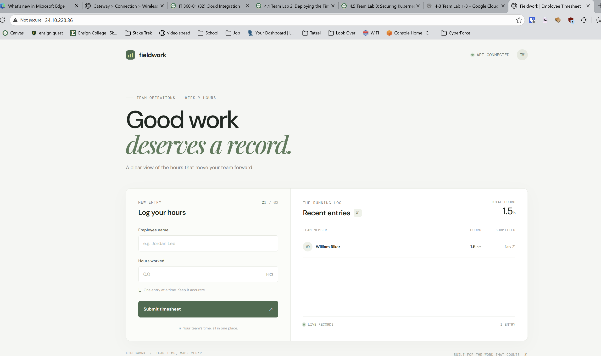
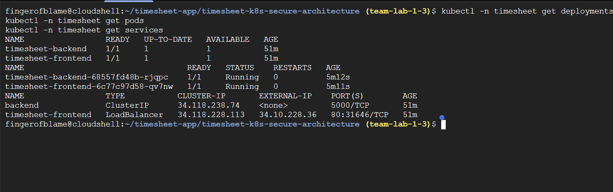

# 4.5 Team Lab 3: Securing Kubernetes Application with Google Identity-Aware Proxy (IAP)

This project carries forward the working timesheet app and GKE deployment from Lab 2. The current public frontend is the baseline for adding Google Identity-Aware Proxy (IAP) access control in this lab.

A small full-stack employee timesheet app built with React, Express, Docker, and Kubernetes. Team members can submit hours and see the latest entries and running total.

**Starting point:** [4.4 Team Lab 2 repository](https://github.com/EnsignIT360/timesheet-k8s-secure-architecture).

## Current GKE baseline before IAP

The app is deployed to the `timesheet-gke` cluster in `us-central1`, in the `timesheet` namespace. The frontend is exposed through a `LoadBalancer`; the backend remains behind an internal `ClusterIP` service. Both deployments are available with one running pod each. The backend and frontend pods run as non-root with dropped Linux capabilities and read-only root filesystems.

**Current frontend:** [http://34.10.228.36](http://34.10.228.36)



## Lab 3 IAP plan

The current endpoint is the pre-IAP baseline. The Lab 3 deployment will use a GKE-managed HTTPS Ingress with IAP configured on its backend. The backend API will remain internal. After the IAP endpoint is verified, remove the old public frontend `LoadBalancer` service so it cannot bypass IAP.

IAP on GKE requires a domain name pointed at the HTTPS load balancer. The OAuth client secret will be stored in a Kubernetes Secret and must not be committed to this repository. Configure the OAuth consent screen for external users if the authorized test account is outside the project's Google organization.

### Compliance mapping: ISO/IEC 27001

IAP requires users to authenticate with a Google account before reaching the timesheet application, and IAM grants the IAP access role only to approved users. This supports ISO/IEC 27001 access-control and accountability objectives by enforcing identity-based, least-privilege access and producing access records for review. IAP supports these controls but does not, by itself, make the application or organization compliant.

### Lab 3 evidence to add

- IAP login prompt and authorized access
- Access denied for an authenticated account without the IAP role
- IAM role assignment for `roles/iap.httpsResourceAccessor`
- Cloud Logging records for IAP authentication events

Google Cloud references: [IAP for GKE](https://cloud.google.com/iap/docs/enabling-kubernetes-howto), [GKE Ingress configuration](https://cloud.google.com/kubernetes-engine/docs/how-to/ingress-configuration), [custom OAuth clients for IAP](https://cloud.google.com/iap/docs/custom-oauth-configuration), and [IAP audit logs](https://cloud.google.com/iap/docs/audit-log-howto).

### Kubernetes deployment verification

Both deployments are available, both pods are running, and the frontend LoadBalancer has an external IP.



## Baseline evidence from Lab 2

### Docker containers

The frontend container is running, and the backend container is healthy.


### Timesheet UI with submitted entries


GitHub repository: [EnsignIT360/timesheet-iap-gke](https://github.com/EnsignIT360/timesheet-iap-gke).

## Run the whole app with Docker

Requirements: Docker Desktop with Docker Compose.

From the project root:

```bash
docker compose up --build
```

Open [http://localhost:3000](http://localhost:3000). NGINX serves the frontend and proxies `/api` requests to the backend. The backend is available locally at [http://localhost:5000](http://localhost:5000); its health endpoint is [http://localhost:5000/api/health](http://localhost:5000/api/health).

To stop the containers, press `Ctrl+C`, then run `docker compose down`.

## Run locally without Docker

```bash
npm install
npm install --prefix backend
npm install --prefix frontend
npm run dev
```

The Vite development server is at `http://localhost:3000` and proxies `/api` requests to the backend at `http://localhost:5000`.

## API

| Method | Route | Purpose |
| --- | --- | --- |
| `GET` | `/api/health` | Check that the backend is running |
| `GET` | `/api/timesheet` | List submitted timesheet entries |
| `POST` | `/api/timesheet` | Add an entry with `employeeName` and `hours` |

Example request body:

```json
{"employeeName":"Jordan Lee","hours":8}
```

Entries are kept in backend memory, matching the lab guide. Restarting the backend clears the data.

## Build and publish the containers to Docker Hub

```bash
docker login --username dewfaced
docker build -t dewfaced/timesheet-backend:latest ./backend
docker push dewfaced/timesheet-backend:latest
docker build -t dewfaced/timesheet-frontend:latest ./frontend
docker push dewfaced/timesheet-frontend:latest
```

The frontend NGINX image proxies API requests to the internal `backend` service on port 5000. The Kubernetes manifests use the public Docker Hub images shown above.

## Deploy to the existing Google Kubernetes Engine cluster

Use the existing `timesheet-gke` cluster in `us-central1`; this avoids creating a second cluster. Run the cluster commands in Google Cloud Shell, where your GKE credentials are configured.

1. Clone this Lab 2 repo in Cloud Shell if it is not already there:

   ```bash
   git clone https://github.com/EnsignIT360/timesheet-k8s-secure-architecture.git
   cd timesheet-k8s-secure-architecture
   ```

2. Connect to the existing cluster and apply the manifests:

   ```bash
   gcloud config set project team-lab-1-3
   gcloud container clusters get-credentials timesheet-gke --region us-central1 --project team-lab-1-3
   kubectl apply -k k8s/
   kubectl -n timesheet rollout status deployment/timesheet-backend --timeout=5m
   kubectl -n timesheet rollout status deployment/timesheet-frontend --timeout=5m
   ```

3. Capture deployment evidence and wait for the external IP:

   ```bash
   kubectl -n timesheet get deployments
   kubectl -n timesheet get pods
   kubectl -n timesheet get services
   kubectl -n timesheet get service timesheet-frontend --watch
   ```

Stop the watch after `EXTERNAL-IP` is assigned, then open `http://EXTERNAL-IP` in a browser. The frontend is public; the backend remains internal to the cluster.

Save screenshots of `get deployments`, `get pods`, and `get services` output, plus the app open through the external IP. Add them under `screenshots/lab2/` and include the external IP link in the submission.

The app stores entries in backend memory, so a backend restart clears them. A GKE `LoadBalancer` service can incur cloud charges; remove the service or cluster after the lab if it is no longer needed.

## Team contributions

**Scrum Master:** Alan Sanchez

**Team members present:** Aaron Smith, Abraham Osorio Lagunas, Alan Sanchez

| Team member | Contribution |
| --- | --- |
| Aaron Smith | Built the timesheet application, containerized the services, and deployed the project to Google Kubernetes Engine. |
| Abraham Osorio Lagunas | Attended the team session; contributed project support and Scrum documentation. |
| Alan Sanchez | Scrum Master; supported team coordination. |
| James King JR | Project support. |
| Marco Chiong | Project support. |
| Matias Vazquez | Project support. |

