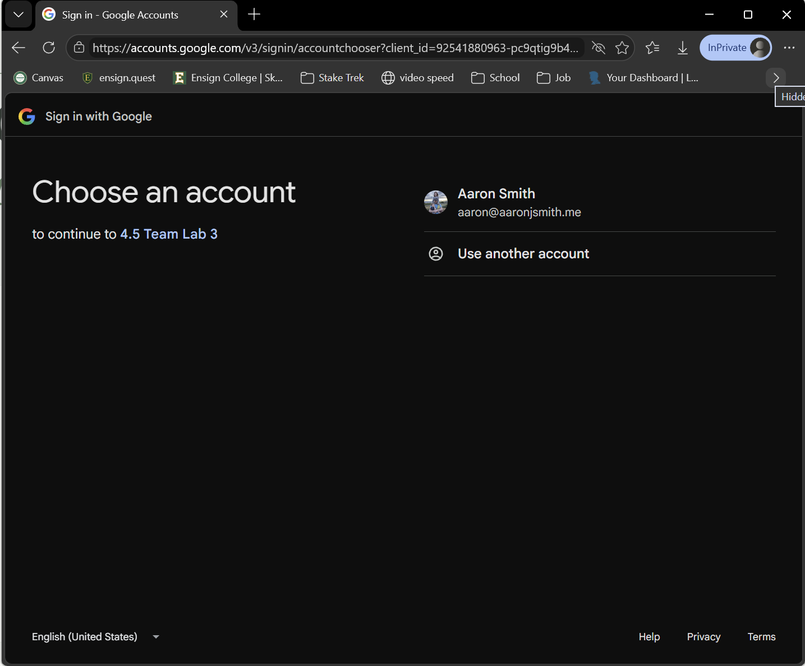
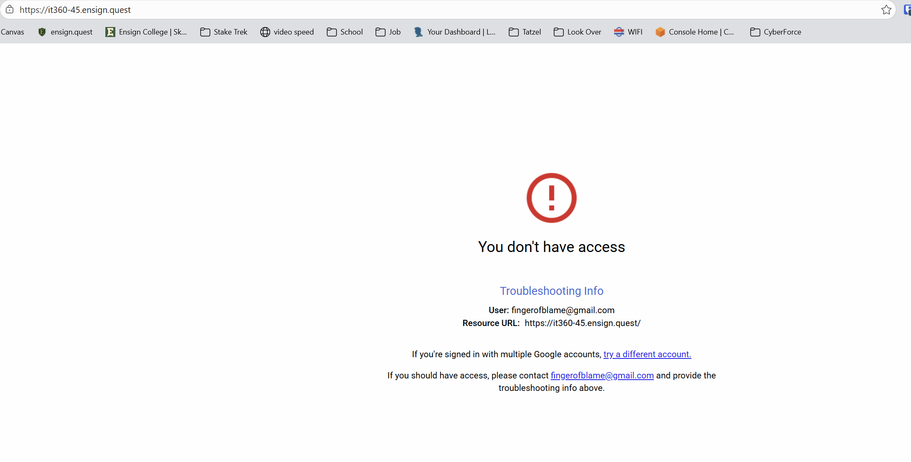
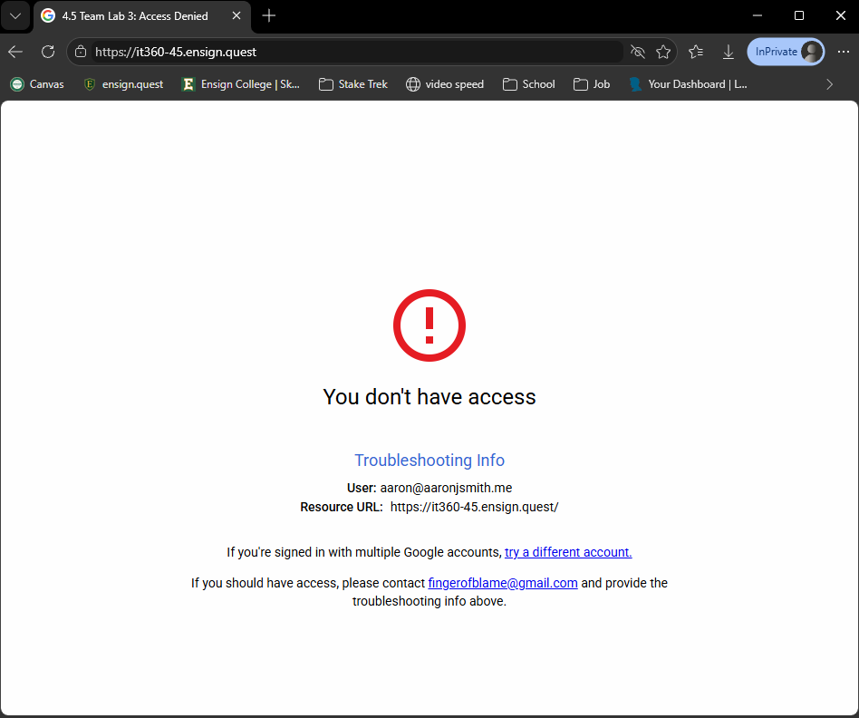
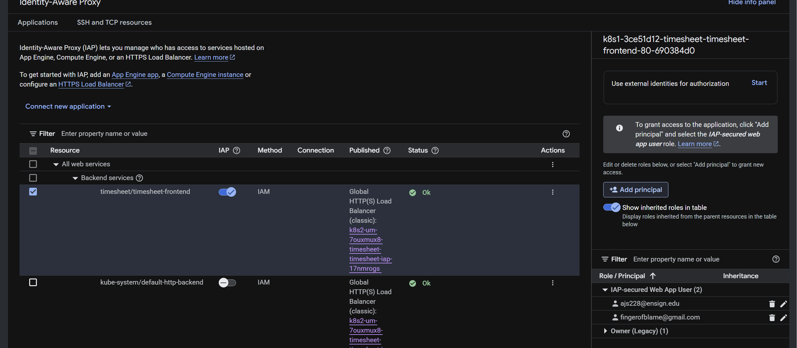
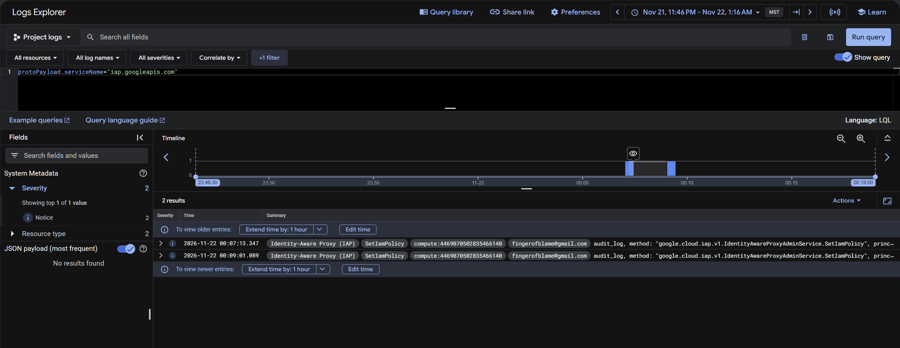

# 4.5 Team Lab 3: Securing Kubernetes Application with Google Identity-Aware Proxy (IAP)

This project carries forward the working timesheet app and GKE deployment from Lab 2. The current public frontend is the baseline for adding Google Identity-Aware Proxy (IAP) access control in this lab.

A small full-stack employee timesheet app built with React, Express, Docker, and Kubernetes. Team members can submit hours and see the latest entries and running total.

**Starting point:** [4.4 Team Lab 2 repository](https://github.com/EnsignIT360/timesheet-k8s-secure-architecture).

**Google Cloud project:** [team-lab-1-3 Console dashboard](https://console.cloud.google.com/home/dashboard?cloudshell=true&project=team-lab-1-3).

## Lab 3 evidence

### IAP sign-in prompt



### Authorized account access



### Unauthorized account denied



### IAP role assignment



### IAP Cloud Audit Logs



## Current GKE baseline before IAP

The app is deployed to the `timesheet-gke` cluster in `us-central1`, in the `timesheet` namespace. The frontend is exposed through a `LoadBalancer`; the backend remains behind an internal `ClusterIP` service. Both deployments are available with one running pod each. The backend and frontend pods run as non-root with dropped Linux capabilities and read-only root filesystems.

**Current frontend:** [http://34.10.228.36](http://34.10.228.36)


## Deploy Lab 3 with IAP

The Lab 3 manifests use a GKE-managed HTTPS Ingress, Google-managed TLS certificate, and a GKE `BackendConfig` that enables IAP. The frontend Service is `ClusterIP`, and the backend API remains internal. This removes the old public frontend `LoadBalancer` path so it cannot bypass IAP.

The hostname `it360-45.ensign.quest` points to the reserved global IP `8.232.145.4` (`timesheet-iap-ip`). Keep this IP reservation and DNS A record in place. The Google-managed certificate can take time to become active after the Ingress is created. The OAuth client secret is stored in a Kubernetes Secret and must not be committed to this repository.

### 1. Configure OAuth

In Google Cloud Console, open **Google Auth Platform** and configure the app branding/consent screen. Select **External** if the test accounts are outside a Google Workspace organization. If the app is in Testing mode, add both the authorized and unauthorized test accounts as OAuth test users so that the unauthorized account can complete sign-in and receive an IAP access-denied result.

Create an OAuth client with application type **Web application**. Add this exact authorized redirect URI, replacing `YOUR_CLIENT_ID` with the generated client ID:

```text
https://iap.googleapis.com/v1/oauth/clientIds/YOUR_CLIENT_ID:handleRedirect
```

In Cloud Shell, create the Kubernetes secret without putting the secret in Git or this chat. Enter the credentials at the prompts; the client secret input is hidden:

```bash
read -rp "OAuth client ID: " IAP_CLIENT_ID
read -rsp "OAuth client secret: " IAP_CLIENT_SECRET; echo
kubectl -n timesheet create secret generic timesheet-iap-oauth \
  --from-literal=client_id="$IAP_CLIENT_ID" \
  --from-literal=client_secret="$IAP_CLIENT_SECRET"
unset IAP_CLIENT_ID IAP_CLIENT_SECRET
```

If the secret already exists, use `kubectl -n timesheet delete secret timesheet-iap-oauth` before recreating it.

### 2. Apply the IAP ingress

Run these commands in Cloud Shell. They reuse the existing `timesheet-gke` cluster and project:

```bash
gcloud config set project team-lab-1-3
gcloud services enable iap.googleapis.com compute.googleapis.com cloudresourcemanager.googleapis.com iam.googleapis.com
gcloud container clusters get-credentials timesheet-gke --region us-central1 --project team-lab-1-3
cd ~
git clone https://github.com/EnsignIT360/timesheet-iap-gke.git
cd timesheet-iap-gke
kubectl apply -k k8s/
kubectl -n timesheet rollout status deployment/timesheet-backend --timeout=5m
kubectl -n timesheet rollout status deployment/timesheet-frontend --timeout=5m
kubectl -n timesheet get ingress,managedcertificate,backendconfig,services
```

The service should change to `ClusterIP` and the Ingress will provision a Google HTTPS load balancer on `8.232.145.4`. Check progress with:

```bash
kubectl -n timesheet describe ingress timesheet-iap
kubectl -n timesheet describe managedcertificate timesheet-iap-cert
kubectl -n timesheet get events --sort-by=.lastTimestamp
```

Wait until the Ingress has address `8.232.145.4` and the managed certificate reports `Active`, then open [https://it360-45.ensign.quest](https://it360-45.ensign.quest). Certificate provisioning may take up to an hour. The previous direct frontend IP `34.10.228.36` is no longer a supported access path after the frontend Service changes to `ClusterIP`.

### 3. Grant IAP access and verify

In **Security > Identity-Aware Proxy** in Google Cloud Console, locate the generated HTTPS backend service. Add only the authorized account with **Cloud IAP > IAP-secured Web App User** (`roles/iap.httpsResourceAccessor`). Do not grant this role to the unauthorized test account. Google-managed OAuth clients only support users within the organization; use a custom OAuth client for external Google accounts.

Verify that the authorized account can sign in and load the app, and that the unauthorized test account reaches the IAP access-denied page. Capture the prompt before sign-in and the denied result. For command-line evidence, capture:

```bash
kubectl -n timesheet get deployments
kubectl -n timesheet get pods
kubectl -n timesheet get services
kubectl -n timesheet get ingress
```

Save Lab 3 screenshots under `screenshots/lab3/`. IAP on GKE uses a GKE Ingress and a `BackendConfig` associated with its frontend service; the service annotation activates the IAP configuration. See [Google's GKE IAP guide](https://cloud.google.com/iap/docs/enabling-kubernetes-howto).

### Sample compliance summary: ISO/IEC 27001

> Google Identity-Aware Proxy (IAP) protects the Timesheet app by requiring users to sign in with Google and checking their IAM permissions before allowing access. Assigning the IAP-secured Web App User role only to approved accounts supports identity-based access control, while IAP audit logs can help track access and policy activity. These measures support security practices relevant to an information security management system, but using IAP alone does not make the app or team ISO/IEC 27001 compliant or certified. [Google Cloud IAP overview](https://docs.cloud.google.com/iap/docs/concepts-overview), [IAP audit logging](https://docs.cloud.google.com/iap/docs/audit-log-howto), [ISO/IEC 27001](https://www.iso.org/standard/27001)

### Lab 3 evidence status

- [x] IAP sign-in prompt
- [x] Authorized account access
- [x] [Access denied for an authenticated account without the IAP role](screenshots/lab3/access-denied.png)
- [x] [IAM role assignment for `roles/iap.httpsResourceAccessor`](screenshots/lab3/iam-role-assignment.png)
- [x] Cloud Logging IAP audit log evidence (the captured entries show `SetIamPolicy` events)

To capture access events, open [Logs Explorer](https://console.cloud.google.com/logs/query?project=team-lab-1-3), select the `Compute Engine Backend Service` resource and the `data_access` log type, and set the time range to include your authorized and denied tests. You can also run this query:

```text
protoPayload.serviceName="iap.googleapis.com"
```

Expand matching entries to show the principal and whether access was granted, then capture the results. Google's [IAP access logging guide](https://cloud.google.com/iap/docs/cloud-iap-context-aware-access-howto) describes where authorized and unauthorized request entries appear in Logs Explorer.

#### Unauthorized account denied


Google Cloud references: [IAP for GKE](https://cloud.google.com/iap/docs/enabling-kubernetes-howto), [GKE Ingress configuration](https://cloud.google.com/kubernetes-engine/docs/how-to/ingress-configuration), [custom OAuth clients for IAP](https://cloud.google.com/iap/docs/custom-oauth-configuration), and [IAP audit logs](https://cloud.google.com/iap/docs/audit-log-howto).

### Kubernetes deployment verification

Both deployments are available, both pods are running, and the frontend LoadBalancer has an external IP.


## Baseline evidence from Lab 2

### Docker containers

The frontend container is running, and the backend container is healthy.


### Timesheet UI with submitted entries


GitHub repository: [EnsignIT360/timesheet-iap-gke](https://github.com/EnsignIT360/timesheet-iap-gke).

## Run the whole app with Docker

Requirements: Docker Desktop with Docker Compose.

From the project root:

```bash
docker compose up --build
```

Open [http://localhost:3000](http://localhost:3000). NGINX serves the frontend and proxies `/api` requests to the backend. The backend is available locally at [http://localhost:5000](http://localhost:5000); its health endpoint is [http://localhost:5000/api/health](http://localhost:5000/api/health).

To stop the containers, press `Ctrl+C`, then run `docker compose down`.

## Run locally without Docker

```bash
npm install
npm install --prefix backend
npm install --prefix frontend
npm run dev
```

The Vite development server is at `http://localhost:3000` and proxies `/api` requests to the backend at `http://localhost:5000`.

## API

| Method | Route | Purpose |
| --- | --- | --- |
| `GET` | `/api/health` | Check that the backend is running |
| `GET` | `/api/timesheet` | List submitted timesheet entries |
| `POST` | `/api/timesheet` | Add an entry with `employeeName` and `hours` |

Example request body:

```json
{"employeeName":"Jordan Lee","hours":8}
```

Entries are kept in backend memory, matching the lab guide. Restarting the backend clears the data.

## Build and publish the containers to Docker Hub

```bash
docker login --username dewfaced
docker build -t dewfaced/timesheet-backend:latest ./backend
docker push dewfaced/timesheet-backend:latest
docker build -t dewfaced/timesheet-frontend:latest ./frontend
docker push dewfaced/timesheet-frontend:latest
```

The frontend NGINX image proxies API requests to the internal `backend` service on port 5000. The Kubernetes manifests use the public Docker Hub images shown above.

## Deploy to the existing Google Kubernetes Engine cluster

Use the existing `timesheet-gke` cluster in `us-central1`; this avoids creating a second cluster. Run the cluster commands in Google Cloud Shell, where your GKE credentials are configured.

1. Clone this Lab 2 repo in Cloud Shell if it is not already there:

   ```bash
   git clone https://github.com/EnsignIT360/timesheet-k8s-secure-architecture.git
   cd timesheet-k8s-secure-architecture
   ```

2. Connect to the existing cluster and apply the manifests:

   ```bash
   gcloud config set project team-lab-1-3
   gcloud container clusters get-credentials timesheet-gke --region us-central1 --project team-lab-1-3
   kubectl apply -k k8s/
   kubectl -n timesheet rollout status deployment/timesheet-backend --timeout=5m
   kubectl -n timesheet rollout status deployment/timesheet-frontend --timeout=5m
   ```

3. Capture deployment evidence and wait for the external IP:

   ```bash
   kubectl -n timesheet get deployments
   kubectl -n timesheet get pods
   kubectl -n timesheet get services
   kubectl -n timesheet get service timesheet-frontend --watch
   ```

Stop the watch after `EXTERNAL-IP` is assigned, then open `http://EXTERNAL-IP` in a browser. The frontend is public; the backend remains internal to the cluster.

Save screenshots of `get deployments`, `get pods`, and `get services` output, plus the app open through the external IP. Add them under `screenshots/lab2/` and include the external IP link in the submission.

The app stores entries in backend memory, so a backend restart clears them. A GKE `LoadBalancer` service can incur cloud charges; remove the service or cluster after the lab if it is no longer needed.

## Team contributions

**Scrum Master:** Alan Sanchez

**Team members present:** Aaron Smith, Abraham Osorio Lagunas, Alan Sanchez

| Team member | Contribution |
| --- | --- |
| Aaron Smith | Built the timesheet application, containerized the services, and deployed the project to Google Kubernetes Engine. |
| Abraham Osorio Lagunas | Attended the team session; contributed project support and Scrum documentation. |
| Alan Sanchez | Scrum Master; supported team coordination. |
| James King JR | Project support. |
| Marco Chiong | Project support. |
| Matias Vazquez | Project support. |

